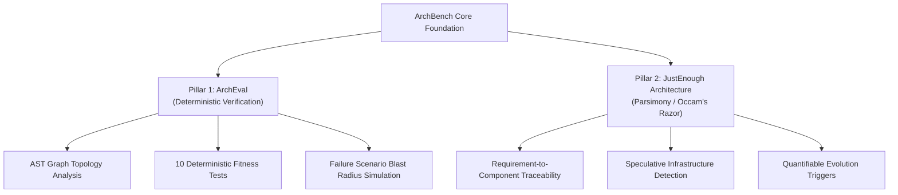
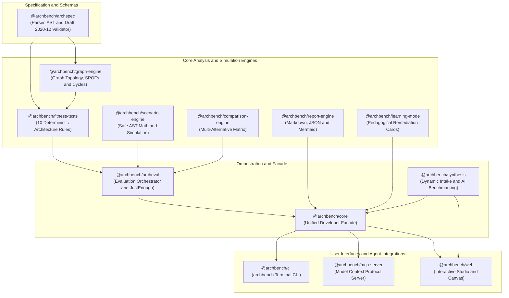
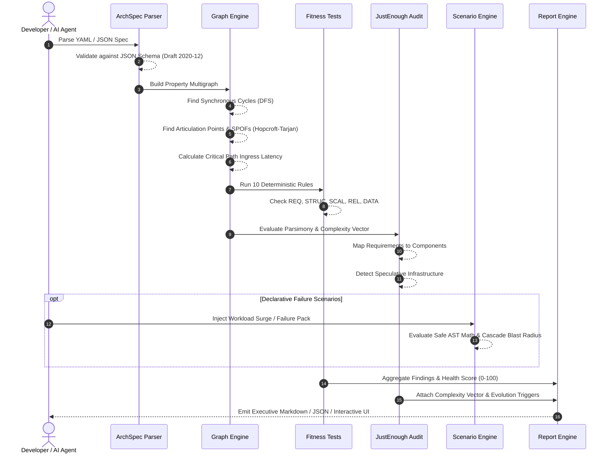
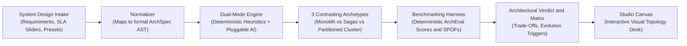

# ArchBench System Architecture

**Test your architecture. Challenge your assumptions.**

This document provides a comprehensive technical reference for the architecture, design principles, data flow, package topology, and evaluation mechanisms of **ArchBench**—an open-source framework for deterministic system design reasoning, architecture evaluation, and failure-driven validation built for developers and AI coding agents.

---

## 1. Core Architectural Mission & Philosophy

### 1.1. The AI Architecture Problem
AI coding assistants have made generating application code and infrastructure diagrams trivial. However, generated architectures frequently conceal weak assumptions, speculative scaling, and unjustified complexity:
- Recommending microservice splits and distributed streaming clusters for sub-50 RPS workloads.
- Introducing single points of failure (SPOFs) disguised behind multi-container Docker compose files.
- Omitting idempotency keys, dead-letter queues, and transactional outboxes on asynchronous write boundaries.
- Fabricating non-functional requirements without measurable latency, throughput, or availability SLOs.

ArchBench operates on a core tenet:
> **"Don't ask an AI model to tell you which architecture is best. Make it demonstrate why its proposed architecture is appropriate for the requirements."**

### 1.2. The Two Foundational Pillars



1. **ArchEval (The Deterministic Verification Engine):**
   Treats high-level design (HLD) declarations as testable code. Validates architectures against explicit requirements, graph invariants (acyclicity, fault tolerance, replication), quality attributes, and declarative failure scenarios.
2. **JustEnough Architecture (The Parsimony Principle):**
   Enforces that every layer of complexity must earn its place. Measures an architectural complexity vector, flags premature over-engineering, and records concrete evolution triggers justifying future scaling transitions.

### 1.3. Zero-Network Default (ADR-010)
All core analysis, graph algorithms, fitness tests, scenario simulations, and benchmark evaluations execute **100% locally with zero external network dependencies**, guaranteeing deterministic reproducibility, air-gapped security, and sub-5ms evaluation speeds.

---

## 2. Monorepo Package Ecosystem & Topology

ArchBench is structured as an npm/pnpm workspace monorepo with clean separation between pure domain logic, evaluation engines, interfaces, and developer applications:



### Package Directory & Responsibilities

| Package | Path | Responsibility |
| :--- | :--- | :--- |
| **`@archbench/archspec`** | `packages/archspec/` | Parses and validates ArchSpec YAML/JSON declarations against JSON Schema Draft 2020-12 with source AST location mapping. |
| **`@archbench/graph-engine`** | `packages/graph-engine/` | Builds directed property multigraphs; computes synchronous cycles, articulation points (SPOFs), and critical path latency. |
| **`@archbench/fitness-tests`** | `packages/fitness-tests/` | Executes 10 deterministic architectural rules across requirements, structure, scalability, reliability, and data consistency. |
| **`@archbench/scenario-engine`** | `packages/scenario-engine/` | Evaluates declarative failure scenarios using a safe recursive-descent AST math parser with zero runtime `eval()`. |
| **`@archbench/comparison-engine`**| `packages/comparison-engine/`| Compares multi-alternative candidate architectures side-by-side, generating trade-off matrices and conditional recommendations. |
| **`@archbench/report-engine`** | `packages/report-engine/` | Formats evaluation outcomes into Executive Markdown, JSON Schema v1, and Mermaid diagrams. |
| **`@archbench/learning-mode`** | `packages/learning-mode/` | Powers CLI remediation cards (`archbench explain`), 32 ArchBench Academy curriculum lessons, 10 simulation kernels, 3 Break & Fix YAML labs, BOE estimator, 15 case studies, and 42 flashcards. |
| **`@archbench/archeval`** | `packages/archeval/` | Orchestrates the full evaluation pipeline, computes the health scorecard, and runs the JustEnough complexity audit. |
| **`@archbench/synthesis`** | `packages/synthesis/` | Dynamic System Design Intake Studio, normalizer, heuristic synthesizer, and multi-candidate benchmarking harness. |
| **`@archbench/core`** | `packages/core/` | Unified programmatic facade aggregating all engines into a single developer SDK (`ArchBenchEngine`). |
| **`@archbench/cli`** | `apps/cli/` | Production command-line tool (`archbench`) with commands: `init`, `validate`, `evaluate`, `scenario`, `compare`, `explain`, `diagram`, `report`, `tests`, `scenarios`, `ui`. |
| **`@archbench/mcp-server`** | `apps/mcp-server/` | Model Context Protocol server exposing architecture reasoning tools over stdio to Claude Code, Antigravity, and Cursor. |
| **`@archbench/web`** | `apps/web/` | Interactive Web Studio with Grey Chrome / Technical Drafting Desk canvas, dynamic intake studio, stress lab, and spec editor. |

---

## 3. Data Flow & Evaluation Lifecycle

When an architecture is evaluated—either via the CLI, MCP server, or Interactive Web Studio—it flows through a deterministic 6-stage pipeline:



---

## 4. Deterministic Fitness Test Engine

ArchBench replaces arbitrary architectural debates with 10 deterministic, automated quality rules:

| Rule ID | Category | Name | Detection Invariant |
| :--- | :--- | :--- | :--- |
| **`REQ-COV-001`** | Requirements | Unmapped Functional Requirement | Every functional requirement (`REQ-FUNC-*`) must map to at least one servicing component. |
| **`REQ-COV-002`** | Requirements | Unmeasurable NFR | Every non-functional requirement (`NFR-*`) must define quantifiable SLO targets (e.g. latency ms, availability %). |
| **`STRUC-001`** | Structure | Deep Synchronous Call Chain | Synchronous HTTP/gRPC call depth must not exceed 3 hops without asynchronous queueing to prevent cascading timeouts. |
| **`STRUC-002`** | Structure | Shared Database Anti-Pattern | A database or state store must not have incoming read/write edges from multiple discrete services without explicit data ownership. |
| **`SCAL-001`** | Scalability | Queue Overload & Unconsumed Topics | Message queues and event streams must specify overflow policies (`reject`, `dlq`, `drop_oldest`) and have active consumers. |
| **`REL-001`** | Reliability | Missing Retry & Backoff Policy | Inter-service connections crossing network boundaries must configure max retries with exponential backoff and jitter. |
| **`REL-002`** | Reliability | Missing Consumer Idempotency | Asynchronous message consumers on at-least-once transports must specify idempotency keys or deduplication mechanisms. |
| **`REL-003`** | Reliability | Missing Dead-Letter Queue (DLQ) | Asynchronous messaging topologies handling business writes must declare a quarantine DLQ target for poison-pill messages. |
| **`REL-004`** | Reliability | Critical Path Single Point of Failure | Graph articulation points on primary ingress paths with `replicas <= 1` and no automated failover are flagged as critical SPOFs. |
| **`DATA-001`** | Data | Distributed Dual-Write Inconsistency | Services executing dual-writes across separate state stores must declare a Transactional Outbox or Saga to prevent data drift. |

### Scoring Algorithm
$$Score = 100 - (CriticalCount \times 25) - (WarningCount \times 10)$$
- **Score $\ge$ 90 with 0 Critical Risks:** `PASSED [PRODUCTION READY]`
- **Score 70-89:** `WARNING [REMEDIATION RECOMMENDED]`
- **Score < 70 or Critical Risks > 0:** `FAILED [REMEDIATION REQUIRED]`

---

## 5. JustEnough Architecture & Parsimony

The parsimony engine acts as an automated architectural Occam's Razor:
$$\text{"Entities should not be multiplied beyond necessity."}$$

### 5.1. Complexity Vector
Every evaluated candidate produces an empirical complexity vector:
$$\vec{C} = \begin{pmatrix} N_{\text{components}} \\ N_{\text{deployables}} \\ N_{\text{network\_hops}} \\ N_{\text{state\_stores}} \\ N_{\text{saas\_deps}} \end{pmatrix}$$

### 5.2. Speculative Infrastructure Detection
Flags premature architectural complexity when heavy infrastructure components (Kafka, Kubernetes, Redis, Cassandra) are introduced without accompanying NFR throughput or latency justifications:
- Example: Flagging a Kafka cluster with 3 brokers when the stated requirement is `50 req/s` with a small 2-engineer team.

### 5.3. Evolution Triggers
Instead of designing for speculative 5-year scale upfront, ArchBench documents explicit **Evolution Triggers**: concrete metric thresholds that tell the engineering team when it is time to evolve the architecture:
- *Example:* "Transition from single PostgreSQL database to Read Replicas when read query volume exceeds 5,000 QPS sustained for > 15 minutes."

---

## 6. Dynamic System Design Intake & Synthesis Studio

Located in `@archbench/synthesis`, this module provides an end-to-end intake and comparative benchmarking pipeline:



### Supported Iconic Presets
1. **Uber Ride Dispatch Platform:** Real-time driver geospatial matching, dynamic surge pricing, and asynchronous payment sagas (20k Peak RPS).
2. **Figma Collaborative Canvas:** Multi-user collaborative document engine with operational transformation / CRDTs and sub-40ms WebSocket synchronization.
3. **Robinhood Financial Ledger:** High-frequency trading engine and double-entry bookkeeping ledger with strict serializability and transactional outbox.
4. **Netflix Video Pipeline:** Global video upload, distributed chunk transcoding, CDN caching, and adaptive bitrate streaming (50k Peak RPS).
5. **IoT Telemetry Platform:** Large-scale sensor telemetry ingestion, high-write time-series storage, and automated anomaly detection (100k Peak RPS).
6. **Enterprise RAG Search Engine:** Multi-tenant document ingestion, chunking, dense vector embeddings, and hybrid semantic retrieval.

---

## 7. Interactive Web Studio (`@archbench/web`)

The Web Studio is designed as a professional engineering instrument featuring a **Grey Chrome, Brushed Titanium, and Pencil Sketch / Architectural Drafting Desk** aesthetic:

- **Home Launchpad & Browse Designs Gallery:** Minimalist entry experience linking directly to **Design System** (`SystemDesignIntakeModal`), **ArchBench Academy** (`LearnStudioView`), and **Browse Designs** across workspace specs and 15 classic architecture blueprints.
- **ArchBench Academy (`LearnStudioView`):** Interactive learning studio with 5 curriculum tracks (32 lessons), 10 interactive visual simulators, 3 live Break & Fix YAML lab missions with real-time XP verification, and an Interview Prep Primer (4-stage delivery framework, BOE capacity estimator, 15 system case studies, and 42 flashcards).
- **Machined Titanium Chassis:** Precision 1px top highlight bevels, tactile hardware buttons, and metal rack tab bar.
- **Precision Drafting Desk Grid:** Millimeter graph paper background with primary 40px lines and 8px subdivisions.
- **Architectural Drafting Blocks:** Component cards featuring graphite pencil borders, uppercase monospace classification badges (`[SERVICE]`, `[MESSAGE_QUEUE]`, `[BACKGROUND_WORKER]`), technical in/out degrees, and corner `+` draftsman crosshairs.
- **Collision-Avoidance Detour Routing:** Multi-tier edges that bypass intermediate tiers automatically route around obstacle cards in open channels.
- **Stress Testing Laboratory:** Interactive surge simulation slider (`1x (Nominal)` to `20x (Extreme)`) with live queue lag telemetry and blast radius illumination.
- **Live YAML Spec Editor & Workspace Assets:** In-browser ArchSpec YAML editor with real-time graph re-evaluation, plus root `assets/` static and Vite-bundled serving at `/assets/...`.

---

## 8. Model Context Protocol (MCP) Server

ArchBench implements an official MCP server in `apps/mcp-server` adhering to the open Model Context Protocol specification over `StdioServerTransport`:

### Exposed MCP Tools

```json
[
  {
    "name": "archbench_validate_spec",
    "description": "Validates an ArchSpec YAML/JSON string or file against JSON Schema Draft 2020-12 and checks for synchronous cycles."
  },
  {
    "name": "archbench_evaluate",
    "description": "Runs all 10 deterministic fitness tests, JustEnough parsimony check, and produces a full health scorecard."
  },
  {
    "name": "archbench_get_findings",
    "description": "Queries evaluation findings filtered by severity (critical, error, warning, info) or rule category."
  },
  {
    "name": "archbench_get_spec",
    "description": "Retrieves full parsed requirements, constraints, assumptions, components, connections, and ADRs."
  },
  {
    "name": "archbench_run_scenario",
    "description": "Executes a validated declarative failure scenario pack (e.g. core-failures, scalability, data-consistency) against an architecture."
  },
  {
    "name": "archbench_compare",
    "description": "Compares multi-candidate architectures side-by-side, producing trade-off matrices and recommendations."
  },
  {
    "name": "archbench_explain_finding",
    "description": "Explains an architectural rule or concept with rationale, anti-patterns, remediation examples, and post-mortems."
  },
  {
    "name": "archbench_list_scenarios",
    "description": "Discovers available failure and workload scenario packs in packs/scenarios."
  },
  {
    "name": "archbench_list_tests",
    "description": "Lists all 10 registered deterministic architecture fitness tests, optionally filtered by category."
  }
]
```

---

## 9. Architectural Decision Records (ADRs)

Key architectural decisions recorded in `docs/rfcs/`:

- **ADR-001: Core Implementation Language:** TypeScript (ES2022 / Node >= 20) with strict compiler settings, unified monorepo tooling with pnpm, and ESM modules.
- **ADR-002: Architecture Representation:** Versioned ArchSpec YAML format backed by JSON Schema Draft 2020-12 and source AST mapping.
- **ADR-003: Evaluation Philosophy:** Deterministic, non-probabilistic fitness tests producing reproducible scores and machine-readable evidence.
- **ADR-004: Complexity Assessment:** Empirical Complexity Vector with explicit evolution triggers over speculative abstractions.
- **ADR-005: Safe Scenario Execution:** Zero runtime `eval()`; safe recursive-descent AST mathematical expression parser.
- **ADR-006: Primary Interface:** Terminal CLI with exit codes for CI/CD gates, complemented by MCP server for AI agents and Web Studio for interactive modeling.
- **ADR-007: AI Agent Integration:** Native Model Context Protocol (MCP) server over stdio for zero-configuration integration into Claude Code, Cursor, and Antigravity.
- **ADR-008: Report Format:** Dual-format output: human-friendly Executive Markdown with Mermaid diagrams and machine-readable JSON Schema v1.
- **ADR-009: Initial Rule Scope:** Ten core high-impact architectural rules covering distributed system failure modes.
- **ADR-010: Security Model & Zero-Network Default:** 100% offline-first execution; no telemetry, tracking, or network calls during evaluation.

---

## 10. Quality Assurance & Verification Gates

ArchBench enforces 5 automated verification gates before any release:

```bash
pnpm run release:check
```

1. **Gate 1:** JSON Schema Draft 2020-12 Compile & Validation
2. **Gate 2:** Full Monorepo TypeScript Static Analysis (`13 workspace packages, 0 errors`)
3. **Gate 3:** Vitest Unit & Integration Suites (`16 test files, 67/67 tests passing`)
4. **Gate 4:** Golden Reference Examples Validation (`5 reference architectures`)
5. **Gate 5:** 50-Case Empirical Benchmark Suite (`100% Precision, 100% Recall, 100% F1 Score`)

