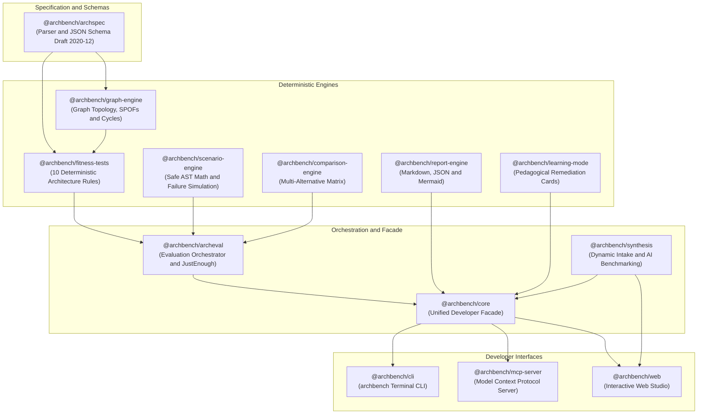

# ArchBench

<div align="center">

**Test your architecture. Challenge your assumptions.**

[](LICENSE)
[](package.json)
[](tsconfig.base.json)
[](CONTRIBUTING.md)

*An open-source framework for deterministic system design reasoning, architecture evaluation, and failure-driven validation—built for developers and AI coding agents.*

[Quickstart](#quickstart) • [Interactive Web Studio](#interactive-web-studio) • [Core Capabilities](#key-capabilities) • [Architecture Docs](ARCHITECTURE.md) • [Contributing](CONTRIBUTING.md)

</div>

---

> **"Don't ask an AI model to tell you which architecture is best. Make it demonstrate why its proposed architecture is appropriate for the requirements."**

---

## Why ArchBench Exists

AI coding assistants have made generating application code, infrastructure configs, and architectural diagrams trivially fast. However, generated outputs frequently conceal weak assumptions, speculative scaling, and unjustified complexity. A model may suggest a microservice topology, Kafka cluster, and Redis layer simply because they appear frequently in training datasets—not because the actual workload, failure modes, or team constraints require them.

ArchBench treats software architecture as something that must be **modeled, reasoned about, tested, and empirically challenged** before production does.

ArchBench unites two foundational principles:
1. **ArchEval:** The deterministic evaluation engine. Validates proposed architectures against explicit requirements, structural invariants, quality attributes, and declarative failure scenarios.
2. **JustEnough Architecture:** The parsimony principle. Enforces that complexity must earn its place by linking every architectural element to a requirement, identifying simpler viable alternatives, and recording explicit evolution triggers.

---

## Architecture & Monorepo Package Ecosystem



For comprehensive architectural specifications, data flows, and design decisions, see [ARCHITECTURE.md](ARCHITECTURE.md).

---

## Key Capabilities

### 1. Machine-Readable Architecture (`@archbench/archspec`)
A strict, versioned YAML/JSON specification format modeling context, requirements, constraints, assumptions, components, connections, deployment replicas, messaging semantics, and ADRs with source AST location mapping.

### 2. Graph & Topology Engine (`@archbench/graph-engine`)
Property multigraph algorithms:
- **Synchronous Cycle Detection:** Identifies deadlocks and circular dependencies.
- **Articulation Points & Single Points of Failure (SPOFs):** Hopcroft-Tarjan biconnected component analysis cross-referenced with component replica counts.
- **Critical Path Latency:** Ingress-to-sink latency accumulation analysis.
- **Mermaid Exporter:** Native diagram generation with visual container boundaries.

### 3. Ten Deterministic Fitness Tests (`@archbench/fitness-tests`)
Automated quality rules executed in parallel with zero flakiness:
- `REQ-COV-001`: Unmapped functional requirements
- `REQ-COV-002`: Unmeasurable NFRs without quantifiable SLO targets
- `STRUC-001`: Deep synchronous call chains (> 3 hops)
- `STRUC-002`: Shared database anti-pattern and unowned state stores
- `SCAL-001`: Queue overload policy & unconsumed message channels
- `REL-001`: Bounded retries and exponential backoff with jitter
- `REL-002`: At-least-once consumer idempotency keys
- `REL-003`: Dead-letter queue (DLQ) quarantine targets
- `REL-004`: Critical path single points of failure (replicas <= 1)
- `DATA-001`: Dual-write distributed state inconsistency hazards (Transactional Outbox check)

### 4. JustEnough Architecture & Parsimony (`@archbench/archeval`)
Measures an empirical architectural complexity vector:
- Component-to-requirement traceability matrix
- Speculative infrastructure detector (flags Kafka, K8s, Redis on small workloads without NFR backing)
- Evolution trigger tracking (explicit thresholds that justify moving to more complex designs)

### 5. Failure-Driven Scenario Simulation (`@archbench/scenario-engine`)
Simulates declarative failure scenarios without running production code:
- **Zero-`eval()` safe AST math evaluator:** Strict recursive-descent expression parser.
- Built-in failure packs: `queue-consumer-lag`, `downstream-timeout`, `traffic-spike`.

### 6. Dynamic System Design Intake & Synthesis (`@archbench/synthesis`)
- **Iconic Blueprints:** Real-Time Ride Dispatch (Uber), Collaborative Canvas (Figma), High-Frequency Financial Ledger (Robinhood), Video Transcoding (Netflix), IoT Telemetry Ingestion, and Enterprise RAG Vector Search.
- **Dual-Mode Synthesis:** Intelligent offline heuristic synthesizer adhering to **ADR-010 Zero-Network Default**, with pluggable AI provider integration.
- **Side-by-Side Benchmarking Matrix:** Automatically synthesizes 3 contrasting candidate archetypes (Lean Monolith vs Event Sagas vs Partitioned Cluster) and benchmarks them on throughput, latency, SPOFs, cost, and evolution triggers.

### 7. Multi-Candidate Alternative Comparison (`@archbench/comparison-engine`)
Side-by-side evaluation of competing architectural choices, generating trade-off delta matrices and conditional recommendations.

### 8. Interactive Web Studio (`@archbench/web`)
A local visual workbench featuring a **Grey Chrome, Brushed Titanium & Architectural Drafting Desk** aesthetic:
- **Precision Topology Desk:** Interactive canvas with millimeter graph paper, architectural swimlanes, and collision-avoidance detour routing.
- **System Design Intake Studio:** Calibrated hardware sliders for RPS, P99 Latency, Availability, Budget, and Team Size.
- **Stress Testing Laboratory:** 1x to 20x traffic surge simulation slider with live telemetry readout.
- **Live YAML Spec Editor:** In-browser specification editor with real-time graph re-evaluation.

### 9. Model Context Protocol Server (`@archbench/mcp-server`)
Enables AI coding agents (Claude Code, Cursor, Antigravity) to validate, evaluate, simulate, compare, and explain system designs directly inside the agent loop over stdio.

### 10. Empirical Benchmark Suite (`benchmarks/`)
50 diverse system designs across 10 architectural archetypes evaluated against curated ground-truth findings:
- **Precision:** 100.00%
- **Recall:** 100.00%
- **F1 Score:** 100.00%
- **Average Latency:** 1.2ms per case

---

## Quickstart

### Prerequisites
- Node.js LTS (v20+ or v22+)
- pnpm (v9+ or v10+)

### Setup

```bash
git clone https://github.com/vishwa98/ArchBench.git
cd ArchBench
pnpm install
pnpm build
```

---

## Interactive Web Studio

Launch the interactive Web Studio:

```bash
pnpm ui
```

Or target a specific port:

```bash
pnpm ui -p 3000
```

Open `http://localhost:3000` to access the visual Topology Desk, System Design Intake Studio, Stress Lab, and Spec Editor.

---

## CLI Commands

The `archbench` CLI is available under `apps/cli` or via root `pnpm cli`:

```bash
# Initialize a new specification template
pnpm cli init my-system

# Validate specification syntax, schema rules, and graph cycles
pnpm cli validate examples/notification-platform/archspec.yaml

# Evaluate architecture against all 10 fitness tests and produce scorecard
pnpm cli evaluate examples/notification-platform/archspec.yaml

# Run declarative failure simulation scenarios
pnpm cli scenario run examples/notification-platform/archspec.yaml --pack core-failures

# Compare candidate alternatives side-by-side
pnpm cli compare examples/notification-platform/archspec.yaml

# Explain an architectural rule or concept with real-world post-mortems
pnpm cli explain REL-002 --mode guided
pnpm cli explain outbox --mode quick

# Export Mermaid architecture diagram
pnpm cli diagram examples/notification-platform/archspec.yaml
```

---

## AI Agent Integration (MCP)

Add ArchBench to your Claude Desktop, Cursor, or Antigravity configuration:

```json
{
  "mcpServers": {
    "archbench": {
      "command": "node",
      "args": ["<path-to-archbench>/apps/mcp-server/dist/index.js"]
    }
  }
}
```

See [docs/agent-instructions.md](docs/agent-instructions.md) for recommended AI agent system prompts.

---

## Golden Reference Architectures

ArchBench includes 5 production-grade reference specifications under `examples/`:

1. **`ecommerce-backend`**: High-reliability checkout and inventory fulfillment with transactional outbox and payment dead-letter queues.
2. **`notification-platform`**: Multi-channel alert dispatch platform with prioritization, idempotency keys, and tenant rate limiting.
3. **`url-shortener`**: High-read caching architecture with bloom filters, read replicas, and analytics ingestion.
4. **`rag-document-pipeline`**: Document ingestion, chunking, embedding generation, and hybrid search vector retrieval.
5. **`realtime-chat`**: Distributed WebSocket messaging cluster with Redis Pub/Sub, message archive workers, and presence servers.

---

## Pre-Release Verification Gates

To verify that the monorepo passes all 5 pre-release quality gates:

```bash
pnpm run release:check
```

Summary of gates enforced:
- **Gate 1:** JSON Schema Draft 2020-12 Compile & Validation
- **Gate 2:** Monorepo TypeScript Static Analysis (`13 workspace packages, 0 errors`)
- **Gate 3:** Vitest Unit & Integration Suites (`12 test files, 45/45 tests passing`)
- **Gate 4:** Golden Reference Examples Validation (`5 reference architectures`)
- **Gate 5:** 50-Case Empirical Benchmark Suite (`100% Precision, 100% Recall, 100% F1 Score`)

---

## Contributing

We welcome community contributions! Please review our [Contributing Guide](CONTRIBUTING.md) before submitting pull requests.

---

## License

ArchBench is open-source software licensed under the [Apache 2.0 License](LICENSE).
