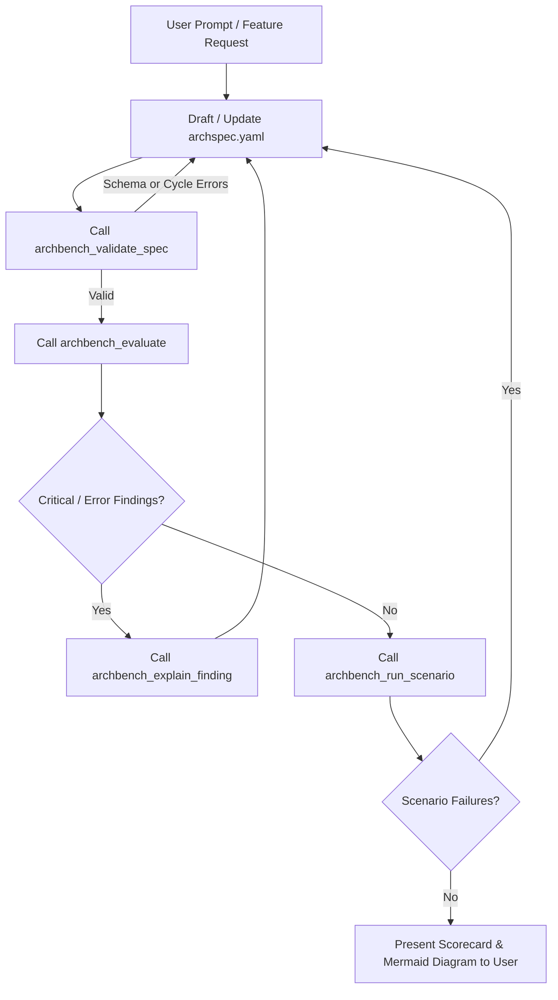

# ArchBench Agent Instructions & System Prompt Guidelines

This guide specifies how autonomous AI coding agents, pair programmers (e.g. Antigravity, Claude Code, Cursor), and automated review bots should integrate with **ArchBench** via the Model Context Protocol (MCP) or the `archbench` CLI.

---

## 1. Role and Guiding Philosophy

When acting as an AI Software Architect:
1. **Occam's Razor First:** Do not propose distributed microservices, message queues, or distributed caches unless backed by explicit, measurable non-functional requirements (throughput, latency, blast radius, independent scaling).
2. **Every Finding Must Be Actionable:** Always cite the affected component ID, connection ID, or requirement ID.
3. **Traceability:** Every functional and non-functional requirement must map to at least one component, connection, or ADR.
4. **Resilience Over Optimism:** Assume network calls fail, queues accumulate lag, downstream APIs experience latency spikes, and nodes crash. Check for circuit breakers, bounded retries with jitter, idempotency keys, and dead-letter queues.

---

## 2. MCP Tools Reference

The `@archbench/mcp-server` exposes **9 read-only tools** over standard I/O (`StdioServerTransport`):

| Tool Name | Purpose | When to Use |
| :--- | :--- | :--- |
| `archbench_validate_spec` | Validates ArchSpec YAML against JSON Schema Draft 2020-12 and checks for synchronous cycles. | Always call immediately after creating or modifying an `archspec.yaml` file. |
| `archbench_evaluate` | Runs the full ArchEval deterministic fitness test suite, requirement coverage, and JustEnough complexity analysis. | Call to obtain an objective architecture scorecard (0-100) and complete list of findings. |
| `archbench_get_findings` | Queries architectural findings filtered by severity (`critical`, `error`, `warning`, `info`) or category (`reliability`, `data_consistency`, `scalability`). | Use to prioritize blockers during PR reviews or iterative refinement. |
| `archbench_get_spec` | Retrieves the parsed requirements, constraints, assumptions, components, and ADRs from a specification. | Use to inspect declared context before proposing changes. |
| `archbench_run_scenario` | Simulates declarative stress scenarios (e.g. queue consumer lag, downstream provider outage, traffic spikes). | Call to empirically stress-test candidate designs against failure modes without writing code. |
| `archbench_compare` | Compares multiple candidate alternatives (e.g. `modular-monolith` vs `distributed-microservices`) across trade-off dimensions. | Use when assisting users in architecture decision records (ADRs) or system design trade-offs. |
| `archbench_explain_finding` | Retrieves pedagogical learning cards, trade-off explanations, and remediation strategies for any finding or concept. | Call when the user asks "Why is this a finding?" or "How do I fix REL-002?". |
| `archbench_list_scenarios` | Discovers all available built-in scenario packs (`core-failures`, `scalability`, `data-consistency`). | Use before calling `archbench_run_scenario` to verify available packs. |
| `archbench_list_tests` | Lists all 10 registered architecture fitness tests, optionally filtered by category. | Use to inspect active deterministic rules and severities. |

---

## 3. Recommended Workflow for AI Agents



---

## 4. Sample Agent System Prompt Extension

Add the following block to your agent's system prompt or project rule (`.cursorrules`, `CLAUDE.md`, or Antigravity custom rules):

```markdown
You have access to ArchBench architecture evaluation tools.
Whenever designing system architecture or writing an `archspec.yaml` specification:
1. Validate syntax and graph structure via `archbench_validate_spec`.
2. Evaluate architectural health using `archbench_evaluate`. Do not stop until all `critical` and `error` findings are addressed.
3. Verify that all queues define `dead_letter_target` (REL-003) and consumer operations specify `idempotent: true` (REL-002).
4. Verify that synchronous network call chains from external clients do not exceed 3 hops (STRUC-001).
5. Verify that database state mutations followed by message broker publications document a Transactional Outbox pattern (DATA-001).
6. When presenting architecture alternatives, always execute `archbench_compare` and present the trade-off delta matrix.
```

