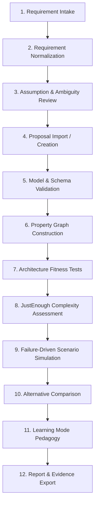

# ArchEval: The 12-Stage Architecture Evaluation Workflow

ArchEval transforms an informal architecture proposal into evidence-backed findings, complexity vectors, and explainable scorecards.

---

## The 12-Stage Pipeline

---

## Detailed Pipeline Stages

1. **Requirement Intake:** Ingests specifications from ArchSpec YAML, markdown briefs, or existing repositories.
2. **Requirement Normalization:** Classifies requirements into functional, availability, latency, throughput, and consistency categories.
3. **Assumption & Ambiguity Review:** Surfaces unverified assumptions and classifies confidence levels (`confirmed`, `assumed`, `unknown`).
4. **Proposal Import:** Parses one or more candidate architectures into internal typed data structures.
5. **Model Validation:** Validates against JSON Schema Draft 2020-12 and checks reference integrity (every connection endpoint must resolve).
6. **Property Graph Construction:** Assembles directed multigraphs, resolving synchronous/asynchronous paths and articulation points.
7. **Fitness Tests:** Executes 10 deterministic rules across requirement coverage, structure, scalability, reliability, and data consistency.
8. **JustEnough Complexity Assessment:** Measures the 5-dimension Complexity Vector and checks component-to-requirement traceability.
9. **Failure-Driven Scenarios:** Evaluates declarative failure packs (queue lag, provider timeout, traffic surge) using zero-`eval()` safe AST math.
10. **Alternative Comparison:** Aligns competing alternatives side-by-side, generating trade-off matrices and conditional recommendations.
11. **Learning Mode:** Maps findings to pedagogical cards providing root-cause explanations and remediation options.
12. **Report & Evidence Export:** Generates GitHub Flavored Markdown reports, machine-readable JSON reports, and Mermaid diagrams.

