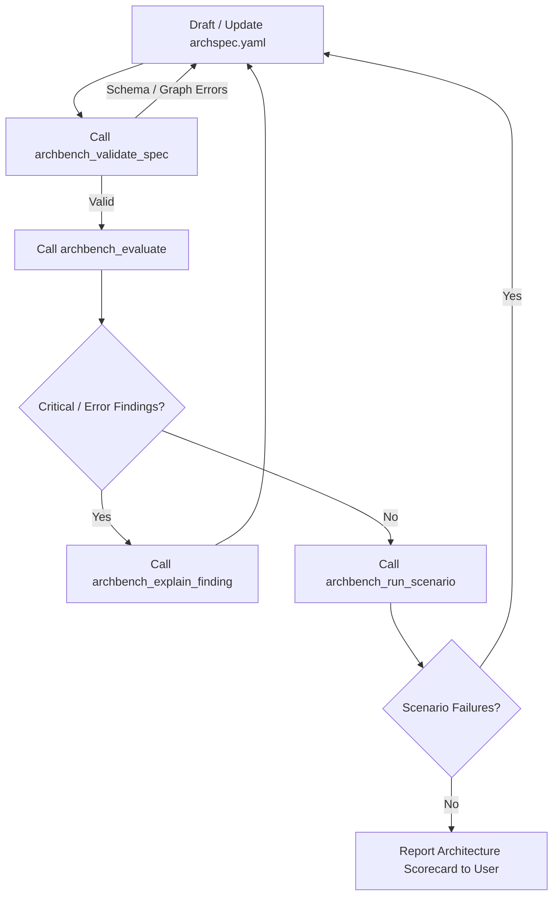

# Model Context Protocol (MCP) Integration Guide

ArchBench provides native Model Context Protocol (MCP) support over standard I/O (`StdioServerTransport`), enabling AI coding assistants (Claude Code, Cursor, Antigravity, Gemini CLI) to evaluate and reason about software architectures directly in-process.

---

## 1. Registering the Server

Add the server to your IDE or agent configuration (`~/.cursor/mcp.json` or `claude_desktop_config.json`), or invoke the compiled binary via `archbench-mcp`:

```json
{
  "mcpServers": {
    "archbench": {
      "command": "node",
      "args": ["/path/to/ArchBench/apps/mcp-server/dist/index.js"]
    }
  }
}
```

---

## 2. Available MCP Tools

| Tool Name | Parameters | Purpose |
| :--- | :--- | :--- |
| `archbench_validate_spec` | `filePath?`, `specYaml?` | Validates syntax, Draft 2020-12 schema, and graph cycles. |
| `archbench_evaluate` | `filePath?`, `specYaml?`, `alternativeId?` | Runs full evaluation pipeline, computing health score and findings. |
| `archbench_get_findings` | `filePath?`, `specYaml?`, `severity?`, `category?` | Queries findings filtered by severity or category. |
| `archbench_get_spec` | `filePath?`, `specYaml?` | Retrieves full parsed specification, requirements, components, and decisions. |
| `archbench_run_scenario` | `filePath`, `pack?`, `alternativeId?` | Challenges candidate design with declarative failure scenarios. |
| `archbench_compare` | `filePath` | Compares multiple candidate alternatives side-by-side. |
| `archbench_explain_finding` | `conceptOrId`, `mode?` | Retrieves pedagogical learning card and remediation strategies. |
| `archbench_list_scenarios` | *(none)* | Discovers all available scenario packs and scenario definitions. |
| `archbench_list_tests` | `category?` | Lists all 10 registered architecture fitness tests. |

---

## 3. Recommended AI Agent Workflow



